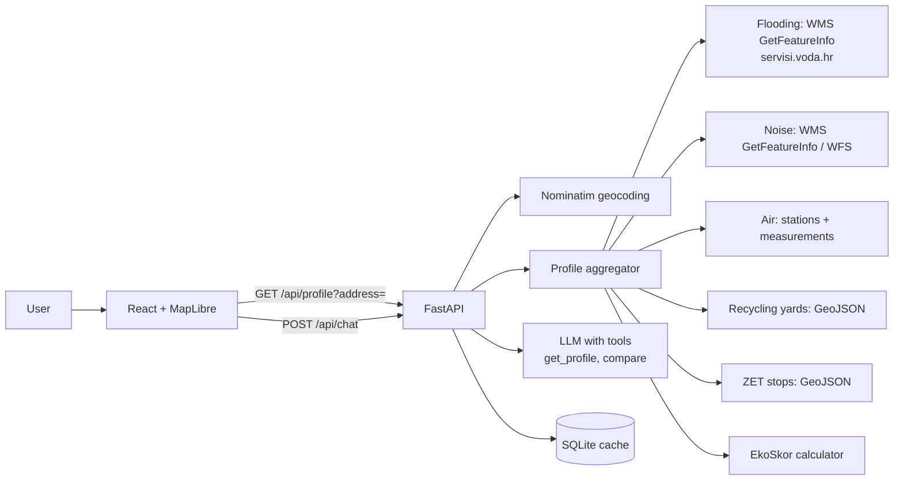

# EkoAdresa — project plan

> **Challenge:** B) Okoliš i održivi prostor (Environment and sustainable space) — Datathon Portala otvorenih podataka (MPUDT)
> **Submission deadline:** 9 Nov 2026 at 24:00, by email to `open.data@mpudt.hr`
> **Time available:** 5 days (5 Nov – 9 Nov 2026)
> **Pilot area:** City of Zagreb (architecture ready for all of Croatia)

---

## Contents

1. [Solution summary](#1-solution-summary)
2. [Goals](#2-goals)
3. [Prerequisites](#3-prerequisites)
4. [Architecture](#4-architecture)
5. [Implementation phases](#5-implementation-phases)
6. [Acceptance criteria](#6-acceptance-criteria)
7. [Risks and fallback plans](#7-risks-and-fallback-plans)
8. [Mapping to the scoring criteria](#8-mapping-to-the-scoring-criteria)

---

## 1. Solution summary

The user types an address and gets the **environmental profile of the location**:

| Layer | What the user sees | Data source |
| --- | --- | --- |
| Flooding | Whether the address is in a high / medium (100-year) / low probability flood zone | Hrvatske vode — Karte opasnosti od poplava (WMS) |
| Noise | Noise level L<sub>den</sub> and L<sub>night</sub> in dB, compared with WHO guidance | Strateška karta buke Grada Zagreba (WMS) / national WFS of strategic noise maps |
| Air | Nearest monitoring station, distance, current air quality index, history | Geoportal Kvaliteta zraka (City of Zagreb), monthly station data, Indeks kvalitete zraka RH |
| Waste | Nearest recycling yard (*reciklažno dvorište*) and green island (*zeleni otok*), walking distance | Reciklažna dvorišta (data.gov.hr / data.zagreb.hr) |
| Green mobility | Number of ZET stops within 300 m / 500 m, nearest stop | ZET bus and tram stops (data.zagreb.hr) |

In addition:

- **EkoSkor 0–100** with an explanation per layer (traffic light green / yellow / red).
- **AI assistant** that answers questions about the address strictly from the fetched data and cites the source.
- **Compare two addresses** side by side with an AI summary of the differences.
- **City view:** heatmap of EkoSkor on a 250 × 250 m grid.

---

## 2. Goals

### 2.1. Competition goals

- [ ] Win 1st place in Challenge B (at least ≥ 50/60 points, the threshold below which the award is not given)
- [ ] Submit the complete solution by **9 Nov 2026 at 20:00** (4 hours of buffer before the official deadline)
- [ ] Meet all mandatory submission elements from Chapter VIII of the Rules: code, technical documentation, demo materials, video ≤ 3 min

### 2.2. Product goals

- [ ] The user gets from typing an address to seeing the profile in ≤ 3 clicks and ≤ 5 seconds
- [ ] The address profile combines at least **5 datasets** from at least **3 different publishers**
- [ ] The AI assistant answers questions in Croatian and cites, for every claim, the dataset it comes from
- [ ] The app works on mobile (375 px width) and desktop (1440 px)

### 2.3. Technical goals

- [ ] All code published on GitHub under an open-source licence (MIT)
- [ ] The app is publicly reachable at a URL for the jury (working prototype) at least until 17 Nov 2026
- [ ] The LLM layer is swappable: works with a commercial API and with an open-source model (Ollama) without code changes, configuration only

### 2.4. Out of scope (we do not build)

- User accounts, login, storing addresses on the server
- Coverage of all of Croatia for every layer (Zagreb only; the rest of Croatia is described as further development)
- Our own ML model for air quality prediction
- Native mobile apps

---

## 3. Prerequisites

### 3.1. Team and roles

| Role | Responsibility |
| --- | --- |
| **Data engineer** | Fetching, cleaning and preparing datasets, checking WMS/WFS services |
| **Backend engineer** | FastAPI, spatial queries, EkoSkor, LLM integration |
| **Frontend engineer** | React app, map, address card, compare view, UX |
| **Lead / presentation** | Documentation, video, communication with the mentor and organiser, testing |

- [ ] Assign each role to a specific team member (one person may hold two roles)
- [ ] Agree on a daily stand-up at 10:00 (15 min) and an evening check at 21:00
- [ ] Tell the mentor which topic we chose and ask for feedback by 6 Nov

### 3.2. Access and accounts

- [ ] GitHub repository `ekoadresa` (public) with access for all members
- [ ] LLM API key (e.g. Anthropic) with a spending limit
- [ ] Ollama installed locally by at least one member (fallback model, e.g. `qwen2.5:7b`)
- [ ] Frontend hosting account (Vercel or Netlify, free plan)
- [ ] Backend hosting account (Render, Railway or Fly.io, free plan)

### 3.3. Development environment

- [ ] Python 3.11+, `uv` or `pip` + `venv`
- [ ] Node.js 20 LTS + `pnpm`
- [ ] QGIS 3.x for manual checks of spatial data
- [ ] Docker (to run the whole system locally with one command)

### 3.4. Tech stack (all open source, except the LLM API, which is swappable)

| Layer | Technology |
| --- | --- |
| Frontend | React 18 + Vite + TypeScript, MapLibre GL JS, Tailwind CSS, Recharts |
| Backend | Python 3.11, FastAPI, Shapely 2, GeoPandas, httpx, pydantic |
| Geocoding | Nominatim (OpenStreetMap), limited to 1 request/s, cached |
| Base map | OpenStreetMap / OpenFreeMap vector tiles |
| Storage | GeoJSON / GeoParquet files in the repository + SQLite cache for WMS responses |
| LLM | Anthropic API (tool calling) or Ollama (OpenAI-compatible endpoint) |

---

## 4. Architecture



### 4.1. API contract

| Method | Endpoint | Description |
| --- | --- | --- |
| `GET` | `/api/geocode?q=Ilica 1, Zagreb` | Returns up to 5 address suggestions with coordinates |
| `GET` | `/api/profile?lat=45.81&lon=15.97` | Returns the full environmental profile + EkoSkor |
| `GET` | `/api/compare?a=lat,lon&b=lat,lon` | Returns two profiles + per-layer differences |
| `POST` | `/api/chat` | `{ "lat", "lon", "message", "history" }` → assistant answer with citations |
| `GET` | `/api/heatmap` | Precomputed EkoSkor grid for Zagreb (GeoJSON) |
| `GET` | `/api/sources` | List of all datasets used, with publishers, licences and links |

### 4.2. Shape of the `/api/profile` response

```json
{
  "location": { "lat": 45.8131, "lon": 15.9772, "address": "Ilica 1, Zagreb" },
  "ekoskor": 72,
  "layers": {
    "flood":    { "status": "green",  "zone": "none", "source_id": "hv-poplave" },
    "noise":    { "status": "red",    "lden_db": 68, "lnight_db": 59, "source_id": "zg-buka" },
    "air":      { "status": "yellow", "station": "Zagreb-1", "distance_m": 850, "index": "umjeren", "measured_at": "2023-12-31", "history": [], "source_id": "zg-zrak-mjerenja" },
    "waste":    { "status": "green",  "yard_name": "Reciklažno dvorište Trešnjevka", "yard_distance_m": 620, "island_distance_m": 140, "source_id": "zg-reciklaza" },
    "mobility": { "status": "green",  "stops_300m": 6, "stops_500m": 11, "nearest_stop": "Trg bana Jelačića", "source_id": "zg-zet" }
  },
  "generated_at": "2026-11-07T14:00:00+01:00"
}
```

Field names follow the `Profile` model in `CLAUDE.md` §2.4 (the source of truth). `history` holds the 30-day series and is left empty here for brevity; `ekoskor` is `null` if fewer than 3 layers are available.

### 4.3. EkoSkor formula (v1)

| Layer | Weight | 100 points | 50 points | 0 points |
| --- | --- | --- | --- | --- |
| Flooding | 25 % | outside all zones | low probability zone | medium or high probability zone |
| Noise (L<sub>den</sub>) | 25 % | ≤ 53 dB (WHO guidance for road traffic) | 54–64 dB | ≥ 65 dB |
| Air | 20 % | index "good" | "moderate" | "poor" or worse |
| Waste | 15 % | yard ≤ 1 km and green island ≤ 300 m | one of the two | neither |
| Mobility | 15 % | ≥ 3 stops within 300 m | 1–2 stops | 0 stops within 500 m |

Between thresholds the value is linearly interpolated. The formula is publicly described in the app (the „Kako računamo?” / "How do we calculate?" button).

---

## 5. Implementation phases

### Phase 0 — Data validation (5 Nov, by 16:00) — **critical, blocks everything else**

**Goal:** confirm that every planned source actually returns data for a single point in Zagreb.

- [x] Call `GetCapabilities` on `servisi.voda.hr/poplave_opasnosti/wms` and record the layer names for all three scenarios
- [x] Run `GetFeatureInfo` for 3 test points (Savica by the Sava, Trg bana Jelačića, Sljeme) and check that the responses differ — *GFI refused (`LayerNotQueryable`); decided to use `GetMap` centre-pixel read against the legend instead (see `docs/data-sources.md`). Savica = low, Jelačić = none, Sljeme = none.*
- [x] Find the actual WMS URL of the City of Zagreb strategic noise map (via the CSW record on `geoportal.nipp.hr`)
- [x] Run `GetFeatureInfo` for noise at the same 3 points; if it returns only an image, record the RGB → dB legend
- [x] Download the „Geoportal Kvaliteta zraka” CSV and the list of monitoring stations with coordinates
- [x] Download the monthly measurement files for at least one station (e.g. Đorđićeva 2023) and record the columns and units
- [x] Determine whether a public source of current (hourly) air quality values exists; if not, use the latest available data and label it clearly
- [x] Download the City of Zagreb recycling yards dataset (data.gov.hr / data.zagreb.hr)
- [x] Download the ZET stops dataset from data.zagreb.hr
- [x] For each dataset, record in `docs/data-sources.md`: name, publisher, URL, format, licence, last update date
- [x] **Go / no-go decision by 16:00:** mark each layer as `OK`, `OK with workaround` or `dropped` — *approved 2026-11-04: flood + waste OK with workaround, noise, air, mobility OK*

**Output:** `docs/data-sources.md` + notebook `notebooks/00_validacija.ipynb` with the query results.

### Phase 1 — Project setup (5 Nov, in parallel with Phase 0)

- [x] Create the monorepo structure:
  ```text
  ekoadresa/
  ├── backend/        # FastAPI
  ├── frontend/       # React + Vite
  ├── data/           # prepared GeoJSON/GeoParquet
  ├── scripts/        # data fetch and preparation scripts
  ├── notebooks/      # validation and analysis
  ├── docs/           # submission documentation
  └── docker-compose.yml
  ```
- [x] Add `LICENSE` (MIT), `README.md` with run instructions, `.gitignore`, `.env.example`
- [x] Set up FastAPI with a `GET /api/health` endpoint that returns `{"status":"ok"}`
- [x] Set up Vite + React + TypeScript + Tailwind + MapLibre with a map centred on Zagreb
- [x] Set up GitHub Actions: `ruff` + `pytest` for the backend, `eslint` + `tsc --noEmit` for the frontend — *+ gitleaks; same commands pass locally (Python 3.11, frozen lockfile); first run on GitHub pending push*
- [x] Set up `docker-compose up` that starts the backend and frontend

### Phase 2 — Data preparation (6 Nov)

- [ ] `scripts/fetch_waste.py`: downloads recycling yards and green islands, normalises into `data/waste.geojson` (EPSG:4326)
- [ ] `scripts/fetch_transit.py`: downloads ZET stops into `data/transit.geojson`
- [ ] `scripts/fetch_air.py`: downloads stations and measurements, computes daily averages per station into `data/air_stations.geojson` and `data/air_history.parquet`
- [ ] `backend/services/wms.py`: generic function `get_feature_info(service_url, layer, lat, lon)` with reprojection to HTRS96/TM (EPSG:3765) when the service requires it
- [ ] Cache WMS responses in SQLite keyed by `(layer, lat rounded to 4 decimals, lon rounded to 4 decimals)`
- [ ] Unit tests: the 3 test points from Phase 0 return the expected values for flooding and noise
- [ ] `scripts/build_heatmap.py`: computes EkoSkor for a 250 × 250 m grid over Zagreb into `data/heatmap.geojson` (run overnight if it takes long)

### Phase 3 — Backend core (6 – 7 Nov)

- [ ] `GET /api/geocode`: proxy to Nominatim with `countrycodes=hr`, a 1 request/s limit and caching
- [ ] `services/flood.py`: returns `high | medium | low | none` for a point
- [ ] `services/noise.py`: returns `lden_db`, `lnight_db` (or a dB range from the legend)
- [ ] `services/air.py`: nearest station (Haversine), distance, latest available index and 30-day history
- [ ] `services/waste.py`: nearest recycling yard and green island with distance in metres
- [ ] `services/mobility.py`: number of stops within 300 m and 500 m, and the nearest stop
- [ ] `services/ekoskor.py`: implementation of the formula from section 4.3 with unit tests for edge values
- [ ] `GET /api/profile`: parallel calls to all services (`asyncio.gather`), 4 s timeout per layer; a layer that does not respond returns `status: "unavailable"` instead of an error
- [ ] `GET /api/compare` and `GET /api/sources`
- [ ] Automatic OpenAPI documentation available at `/docs`

### Phase 4 — AI assistant (7 Nov)

- [ ] System prompt in Croatian: the assistant may only use data obtained through tools, cites a `source_id` with every claim, and says so when data is missing
- [ ] Tools (tool calling): `get_profile(lat, lon)`, `compare(a, b)`, `explain_layer(layer)`, `nearest_facility(type)`
- [ ] `LLMProvider` abstraction with two implementations: `AnthropicProvider` and `OllamaProvider`, selected via the `LLM_PROVIDER` variable
- [ ] `POST /api/chat` with streamed responses (Server-Sent Events)
- [ ] Test set of 10 questions with expected answers in `backend/tests/chat_cases.yaml`, e.g.:
  - „Mogu li spavati s otvorenim prozorom?” ("Can I sleep with the window open?") → must mention L<sub>night</sub> and the WHO guidance
  - „Treba li mi osiguranje od poplave?” ("Do I need flood insurance?") → must state the flood zone and the source (Hrvatske vode)
  - „Kamo s krupnim otpadom?” ("Where do I take bulky waste?") → must name the nearest recycling yard and its distance
- [ ] Safeguards: limit of 20 messages per session and at most 500 characters per message
- [ ] Ready-made AI summary for comparing two addresses (3–4 sentences)

### Phase 5 — Frontend and UX (6 – 8 Nov)

- [ ] Home screen: large address search with autocomplete and 3 example addresses for a quick demo
- [ ] Map: address marker, 500 m circle, toggleable layers (flooding, noise, stations, yards, stops)
- [ ] Address card: EkoSkor as a large number with a ring indicator + 5 traffic-light rows with a one-sentence explanation per layer
- [ ] Air layer detail: chart of the last 30 days (Recharts)
- [ ] AI assistant panel with 4 suggested questions as buttons
- [ ] Compare mode: two cards side by side, differences highlighted with colour, AI summary below
- [ ] "For the city" (*Za grad*) view: EkoSkor heatmap + number of residents in red zones (if population data is available)
- [ ] „Kako računamo?” modal with the EkoSkor formula and links to sources
- [ ] "Data sources" (*Izvori podataka*) page generated from `/api/sources`
- [ ] Loading states (skeleton), empty states and error messages for every layer
- [ ] Responsiveness: check at 375 px, 768 px and 1440 px
- [ ] Accessibility: colour contrast ≥ 4.5:1, traffic light always paired with a text label (not colour alone), keyboard navigation

### Phase 6 — Deploy and testing (8 Nov)

- [ ] Deploy the backend to Render / Railway with the cached data in the repository
- [ ] Deploy the frontend to Vercel / Netlify with the `VITE_API_URL` variable
- [ ] Warm the cache: precompute profiles for the 20 addresses used in the demo and video
- [ ] End-to-end test: 10 hand-picked addresses (centre, Savica, Sesvete, Novi Zagreb, Sljeme, Dubrava…) with no errors
- [ ] Test on mobile (Android and iOS browsers)
- [ ] Measure: `/api/profile` p95 ≤ 5 s with a cold cache, ≤ 1 s with a warm cache
- [ ] 1-hour bug bash with the whole team, fix all blocking bugs

### Phase 7 — Submission documentation (8 – 9 Nov)

- [ ] `README.md`: description, screenshots, demo link, local run instructions (`docker-compose up`)
- [ ] `docs/arhitektura.md`: diagram, component description, API contract, data flow
- [ ] `docs/data-sources.md`: table of all datasets (name, publisher, URL, licence, how it is used) — mandatory under Chapter III of the Rules
- [ ] `docs/integracija.md`: how the solution connects to existing public systems (NIPP, INSPIRE services, e-Građani), standards (OGC WMS/WFS, GeoJSON, OpenAPI), technical, organisational and legal prerequisites for production
- [ ] `docs/ekoskor.md`: methodology, thresholds, limitations
- [ ] `docs/daljnji-razvoj.md`: extension to all of Croatia, bathing water quality, fire risk, air quality change alerts, API for real-estate portals
- [ ] List of open-source tools and AI tools used, with licences (mandatory under Chapter VIII of the Rules)
- [ ] 6–8 screenshots in `docs/screenshots/`

### Phase 8 — Video presentation (9 Nov)

- [ ] Write the script exactly to the required structure, total ≤ 3:00:

  | Time | Content |
  | --- | --- |
  | 0:00–0:20 | Problem: you're looking for a flat, and nobody sees the flood and noise data |
  | 0:20–0:35 | Target users: citizens, buyers and tenants, schools and kindergartens, the city |
  | 0:35–0:55 | Data sources: 5+ datasets, publisher logos |
  | 0:55–2:05 | Demo: type an address → card → AI question → compare two flats → city view |
  | 2:05–2:30 | Technical architecture (diagram) |
  | 2:30–2:50 | User value and further development |
  | 2:50–3:00 | Team name, link to the demo and GitHub |

- [ ] Record the screen in 1080p (OBS Studio) with a pre-warmed cache
- [ ] Record the narration separately, clean audio
- [ ] Edit (DaVinci Resolve or Kdenlive), Croatian subtitles
- [ ] Check the duration is ≤ 3:00 and upload the video (YouTube unlisted or Google Drive with a public link)

### Phase 9 — Submission (9 Nov, by 20:00)

- [ ] Freeze the code: tag `v1.0-datathon` on GitHub
- [ ] Check that the demo URL, GitHub and video are reachable from an incognito browser window
- [ ] Send an email to `open.data@mpudt.hr` with the subject „Datathon — Izazov B — [ime tima] — EkoAdresa” ("[team name]") containing:
  - [ ] link to the public GitHub repository
  - [ ] link to the working prototype
  - [ ] technical and project documentation (PDF attached + link to `docs/`)
  - [ ] demo materials (screenshots)
  - [ ] link to the video presentation
  - [ ] names of team members and the mentor
- [ ] Save the sent confirmation and watch for the organiser's acknowledgement of receipt

---

## 6. Acceptance criteria

### 6.1. Functional

- [ ] Typing the address „Ilica 1, Zagreb” returns a profile with all 5 layers in ≤ 5 s
- [ ] For an address in a known flood zone by the Sava, the flood layer shows a zone other than "outside zones"
- [ ] For an address by a main road (e.g. Slavonska avenija), the noise layer shows L<sub>den</sub> ≥ 65 dB and a red status
- [ ] For an address on Sljeme, EkoSkor is higher than for an address in the city centre
- [ ] Every layer shows the source name and a link to the dataset
- [ ] If one layer is unavailable, the others still render, and the unavailable one shows a clear message
- [ ] Comparing two addresses shows both cards and an AI summary of the differences
- [ ] The AI assistant answers ≥ 8 of 10 questions from `chat_cases.yaml` correctly
- [ ] For a question outside the available data (e.g. „Kolika je cijena kvadrata?” / "What is the price per square metre?"), the AI assistant answers that it does not have that data
- [ ] The Zagreb heatmap loads in ≤ 3 s

### 6.2. Non-functional

- [ ] The app renders correctly at 375 px, 768 px and 1440 px without horizontal scrolling
- [ ] Lighthouse: Performance ≥ 80, Accessibility ≥ 90 on the home page
- [ ] The system starts locally with the single command `docker-compose up` on a clean machine
- [ ] CI (lint + tests) passes on the `main` branch
- [ ] No API keys or secrets in the repository (checked with `gitleaks`)
- [ ] Setting `LLM_PROVIDER=ollama` makes the assistant work without a commercial API

### 6.3. Submission and rule compliance

- [ ] The repository is public and has an open-source licence
- [ ] `docs/data-sources.md` lists every dataset with publisher, link and licence
- [ ] The documentation lists every library and AI tool used
- [ ] The video is ≤ 3:00 and covers: problem, users, data sources, features, architecture, value, further development
- [ ] Demo URL, video and repository are available at least until 17 Nov 2026
- [ ] Email with the solution sent before 9 Nov 2026 at 24:00

---

## 7. Risks and fallback plans

| Risk | Likelihood | Impact | Fallback plan |
| --- | --- | --- | --- |
| Noise WMS does not support `GetFeatureInfo` | Medium | High | Fetch the PNG tile and read the pixel colour against the legend → dB range |
| WMS services slow or down during judging | Medium | High | Aggressive caching + precomputed profiles for demo addresses; fall back to the last cached response |
| No public real-time air quality data | High | Medium | Use the latest available historical data, clearly labelled with its date; describe integration with hourly data as further development |
| Datasets with no stated licence | Medium | Medium | Write to the organiser at `open.data@mpudt.hr` on 5 Nov; state in the documentation that the data is publicly published on the Portal |
| Nominatim blocks us for too many requests | Low | Medium | Cache + 500 ms debounce on the frontend; fallback: Photon (Komoot) |
| LLM hallucinates data | Medium | High | Strict system prompt, answers only from tool results, mandatory `source_id`, test question set |
| Not enough time due to parallel work on Challenge A | High | High | Scope-cut order: 1) city view, 2) compare, 3) air chart. Address card + AI assistant always stay |
| Free hosting "sleeps" and the first request takes 30+ s | High | Medium | Cron ping every 10 min during the judging period (10 – 17 Nov) |

---

## 8. Mapping to the scoring criteria

| Criterion (points) | How EkoAdresa covers it | Evidence in the submission |
| --- | --- | --- |
| Use of open data (1–5) | Direct calls to public-sector WMS/WFS services + downloaded and prepared datasets | `docs/data-sources.md`, code in `backend/services/` |
| Linking publicly available data (1–5) | 5+ datasets from 3+ publishers combined into one profile and EkoSkor | Address card, `docs/ekoskor.md` |
| Relevance (1–5) | Covers air, waste, transport, flooding and noise from the Challenge B description | Video 0:35–0:55, README |
| Impact and community benefit (1–5) | Every citizen choosing a flat or kindergarten; the city gets a map of critical zones | "For the city" view, video 2:30–2:50 |
| Innovation and technology (1–5) | LLM assistant with tools over open data, swappable open-source model | `backend/llm/`, demo AI questions |
| Feasibility (1–10) | Publicly available working prototype, tests, CI, Docker | Demo URL, GitHub Actions |
| Architecture and integration (1–5) | OGC WMS/WFS, GeoJSON, OpenAPI, prerequisites described | `docs/arhitektura.md`, `docs/integracija.md`, `/docs` |
| Overall impression (1–10) | One input → one clear result, traffic light, compare, mobile view | Screenshots, Lighthouse score |
| Presentation (1–10) | Script built exactly to the required structure | Video ≤ 3:00 |
