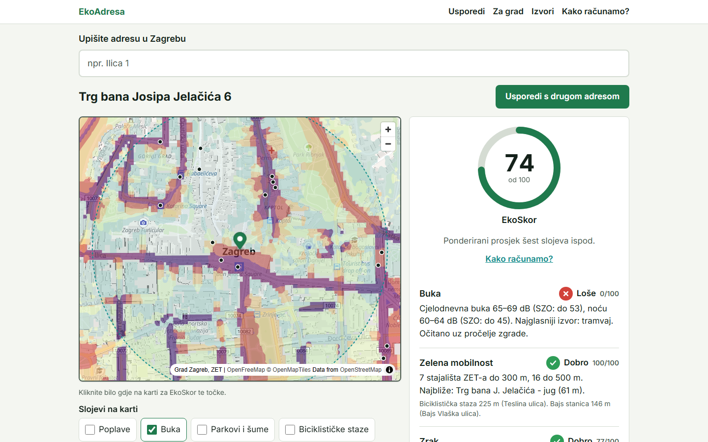
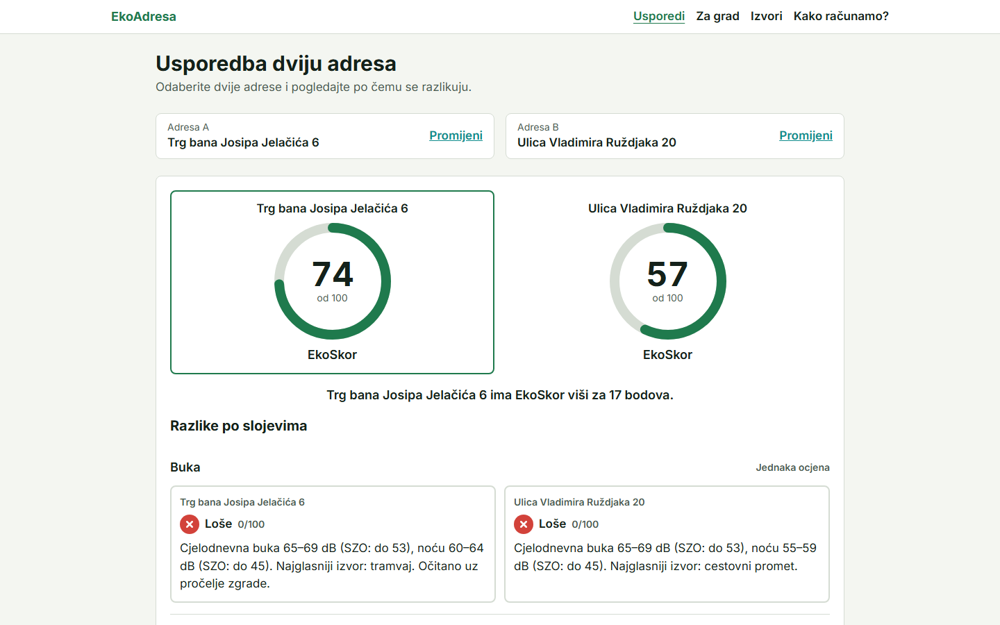
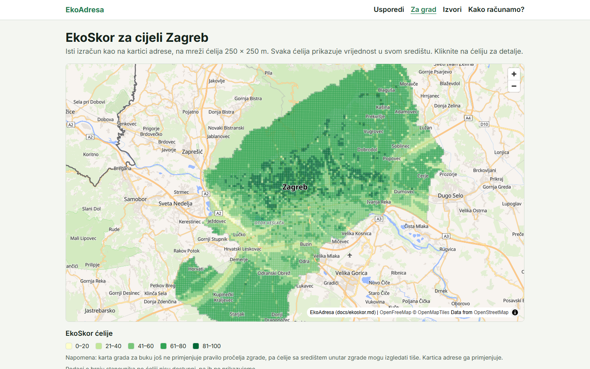
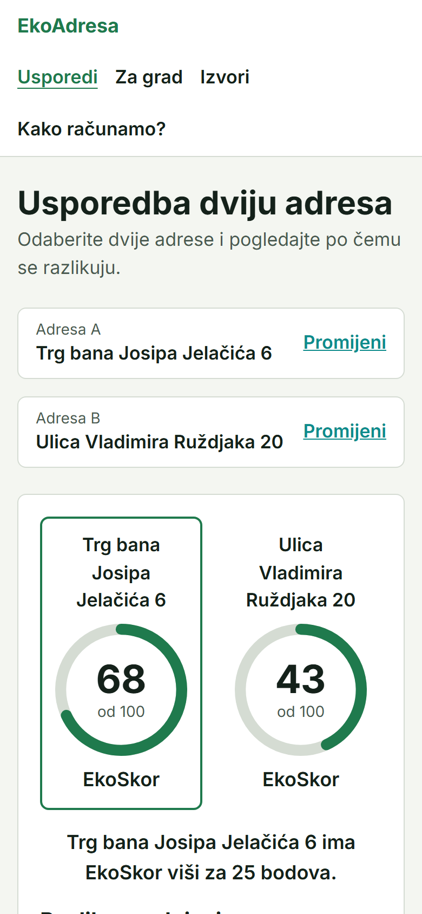

# EkoAdresa

**Kako je živjeti na ovoj adresi?** EkoAdresa za bilo koju adresu u Zagrebu na jednom mjestu prikazuje opasnost od poplava, razinu buke, kvalitetu zraka, blizinu reciklaže te javnog prijevoza, biciklističkih staza i parkova, uz jednu ocjenu: **EkoSkor 0–100**. Svaki podatak dolazi iz javno objavljenih otvorenih podataka; svi izvori s izdavačima i licencijama navedeni su na stranici **Izvori**.

Rješenje za **Datathon Portala otvorenih podataka 2026**, izazov B: *Okoliš i održivi prostor*.

- **Demo:** <https://ekoadresa.vercel.app>
- **API (OpenAPI):** <https://ekoadresa-api.vercel.app/docs>
- **Izvorni kod:** <https://github.com/Filip-Pogac/EkoAdresa> (licencija MIT)



## Problem i korisnici

Podaci o okolišu već postoje u javnim servisima: karte opasnosti od poplava Hrvatskih voda, strateška karta buke Grada Zagreba, mjerenja kvalitete zraka, popisi reciklažnih dvorišta i stajališta. Raspršeni su po geoportalima i tablicama na koje običan građanin ne nailazi i koje ne zna čitati. Kad bira stan za najam ili kupnju, vrtić ili školu, nema jedno mjesto koje kaže: je li ovo dobro mjesto za život i zašto.

- **Građani** koji biraju gdje će živjeti: jedna adresa, jedan jasan odgovor, usporedba dviju adresa.
- **Javna tijela i Grad:** karta EkoSkora za cijeli grad pokazuje gdje nedostaju reciklaža, javni prijevoz ili gdje je buka visoka.
- **Drugi servisi** (portali nekretnina, gradske aplikacije): otvoreni API s izvorom uz svaki podatak.

## Što aplikacija radi

| | |
|---|---|
| **Početna stranica:** pretraga adrese s dovršavanjem upisa (i tipkovnicom), tri primjera ili klik na kartu Zagreba | **Kartica adrese:** EkoSkor i pet slojeva (poplave, buka, zrak, zelena mobilnost, zelenilo), svaki sa semaforom, tekstom i ikonom (ne samo bojom), jednom rečenicom na hrvatskom i datumom podataka (izvori na stranici Izvori) |
| **Karta** s krugom od 500 m i slojevima koji se uključuju: poplave, buka, parkovi i šume, biciklističke staze, stanice javnih bicikala, parkirališta za bicikle, mjerne postaje, reciklažna dvorišta, zeleni otoci, stajališta ZET-a; **klik na kartu** daje EkoSkor bilo koje točke | **Graf mjerenja zraka** po danima uz smjernice SZO-a |
| **Usporedba dviju adresa** s oznakom „Bolje" po sloju | **Za grad:** EkoSkor na mreži 250 × 250 m za cijeli Zagreb |
| **Kako računamo?** cijela formula i pragovi, javno | **Izvori:** svi skupovi s izdavačima, licencijama i poveznicama |

Radi na mobitelu (provjereno na 375, 768 i 1440 px), u svijetloj i tamnoj temi; pristupačnost prema Lighthouseu 100.

| Usporedba dviju adresa | Karta grada | Mobitel |
|---|---|---|
|  |  |  |

Ostale snimke zaslona: [docs/screenshots/](docs/screenshots/).

## Podaci

13 izvora od 5 izdavača, povezanih u jedan profil adrese i jednu ocjenu:

| Sloj | Izvor | Izdavač | Pristup |
|---|---|---|---|
| Poplave | Karte opasnosti od poplava | Hrvatske vode | OGC WMS, uživo |
| Buka | Strateška karta buke Grada Zagreba | Grad Zagreb | OGC WMS, uživo |
| Zrak | Mjerne postaje i mjerenja kvalitete zraka 2023.; Indeks kvalitete zraka u RH (INSPIRE); mjerenja državnih postaja, zadnja 24 sata | Grad Zagreb; data.gov.hr; DHMZ | data.zagreb.hr / data.gov.hr; OGC WFS uživo; meteo.hr uživo |
| Otpad (samo na karti, ne ulazi u EkoSkor) | Reciklažna dvorišta; zeleni otoci | Grad Zagreb; OpenStreetMap | data.zagreb.hr; Overpass API |
| Zelena mobilnost | Autobusna i tramvajska stajališta ZET; biciklističke staze; stanice javnih bicikala | Grad Zagreb | data.zagreb.hr |
| Zelenilo | Parkovi, šume, javni vrtovi i zaštićena područja | OpenStreetMap | Overpass API |
| Adrese, granica | Adrese i granica Grada Zagreba | OpenStreetMap | Overpass API |

Potpun popis s poveznicama, licencijama i datumima: **[docs/data-sources.md](docs/data-sources.md)**. Metodologija EkoSkora: **[docs/ekoskor.md](docs/ekoskor.md)**.

## Kako radi

React frontend (Vercel CDN) poziva FastAPI backend (Vercel, Frankfurt). Backend za svaku adresu istodobno upituje javne WMS/WFS servise i spremljene snimke otvorenih skupova, sprema odgovore servisa i računa EkoSkor prema javnoj formuli. Za 15 nasumičnih adresa odgovor stiže za p95 0,50 s bez predmemorije. Detalji: **[docs/arhitektura.md](docs/arhitektura.md)**.

Aplikacija u radu ne koristi umjetnu inteligenciju: EkoSkor je izračun prema objavljenoj formuli. Za izradu je korišten alat umjetne inteligencije **Claude Code** (Anthropic); popis svih alata i licencija: [docs/alati.md](docs/alati.md).

## Pokretanje

### Docker (preporučeno)

```bash
cp .env.example .env
docker-compose up --build
```

- Frontend: <http://localhost:5173>
- Backend API: <http://localhost:8000> (OpenAPI dokumentacija na `/docs`)

### Lokalni razvoj

Potrebno: Python 3.11+, [uv](https://docs.astral.sh/uv/), Node.js 20+, pnpm.

```bash
# Backend
cd backend
uv sync
uv run uvicorn app.main:app --reload

# Frontend (drugi terminal)
cd frontend
pnpm install
pnpm dev
```

Provjere:

```bash
cd backend && uv run ruff check && uv run pytest
cd frontend && pnpm lint && pnpm typecheck
# End-to-end (Playwright): protiv objavljene stranice ili lokalno s E2E_BASE_URL
cd frontend && npx playwright install chromium && pnpm e2e
E2E_BASE_URL=http://localhost:5173 pnpm e2e
```

Ponovna izrada podataka (iz korijena repozitorija): `uv run --project backend python scripts/<skripta>.py`; popis skripti u [docs/arhitektura.md](docs/arhitektura.md). Snimke zaslona: `cd frontend && node scripts/screenshots.mjs`.

### Objava (Vercel)

Dva Vercel projekta iz istog repozitorija:

- **Backend** (`ekoadresa-api`): korijen repozitorija. `index.py` učitava `backend/app`, a `vercel.json` postavlja regiju `fra1`. Ovisnosti su u `requirements.txt` (izvezeno iz `backend/uv.lock`: `cd backend && uv export --no-dev --no-hashes --no-emit-project -o ../requirements.txt`). Varijabla okruženja: `CORS_ORIGINS` = adresa frontenda. Predmemorija je u `/tmp`; `data/cache_seed.json` (`scripts/warm_cache.py`) unaprijed puni adrese za demo.
- **Frontend** (`ekoadresa`): mapa `frontend/`, Vite. Varijabla okruženja: `VITE_API_URL` = adresa backenda.

```bash
vercel deploy --prod            # u korijenu: backend
cd frontend && vercel deploy --prod
```

## Dokumentacija

| Dokument | Sadržaj |
|---|---|
| [Tehnička arhitektura](docs/arhitektura.md) | Dijagram, komponente, API, tok podataka, pouzdanost, sigurnost, testiranje |
| [Izvori podataka](docs/data-sources.md) | Svi skupovi: izdavač, poveznica, licencija, datum, korištenje ([tehnički zapisnik provjere](docs/data-sources-zapisnik.md)) |
| [EkoSkor: kako računamo](docs/ekoskor.md) | Formula, pragovi, ograničenja |
| [Integracija i preduvjeti](docs/integracija.md) | Standardi, postojeći javni sustavi, tehnički, organizacijski i pravni preduvjeti |
| [Daljnji razvoj](docs/daljnji-razvoj.md) | Cijela Hrvatska, nove teme, obavijesti, AI asistent, API |
| [Korišteni alati](docs/alati.md) | Knjižnice, alati i alati umjetne inteligencije s licencijama |

## Tim

- Rene Filipović
- Filip Pogač
- Matej Šimek

Mentor: Vinko Lešić

## Licencija

Izvorni kod: [MIT](LICENSE). Podaci pripadaju svojim izdavačima i koriste se pod licencijama navedenima u [docs/data-sources.md](docs/data-sources.md); podaci iz OpenStreetMapa © OpenStreetMap contributors, ODbL 1.0.
