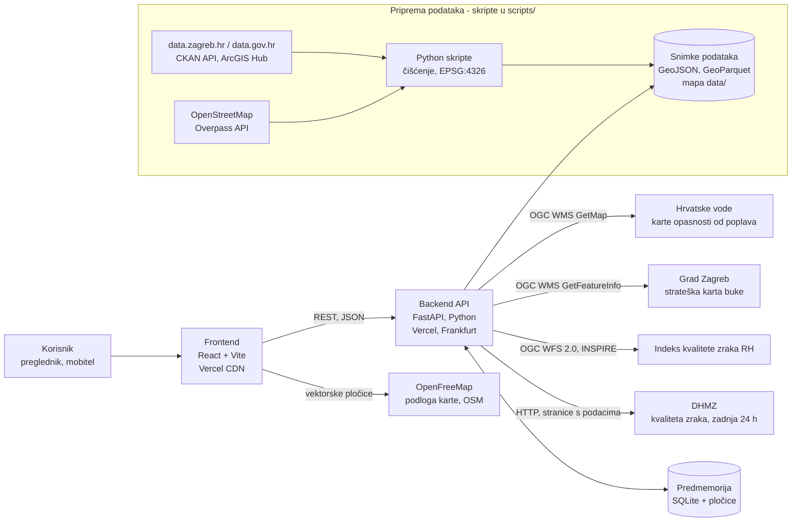

# Tehnička arhitektura

EkoAdresa je web aplikacija s dva dijela: **frontend** (React, statička stranica) i **backend** (Python, FastAPI). Backend za svaku adresu spaja podatke iz javnih servisa (WMS/WFS) i iz spremljenih snimki otvorenih skupova podataka, računa EkoSkor i vraća sve u jednom JSON odgovoru s izvorom za svaki podatak.

- Demo: <https://ekoadresa.vercel.app>
- API i interaktivna dokumentacija (OpenAPI): <https://ekoadresa-api.vercel.app/docs>
- Izvorni kod (MIT): <https://github.com/Filip-Pogac/EkoAdresa>

## 1. Dijagram



**Uživo** se pri svakom upitu (uz predmemoriju) pozivaju četiri javna izvora: poplave, buka, državni indeks zraka i mjerenja DHMZ-a za protekla 24 sata. Ostali podaci (mjerne postaje i mjerenja zraka, reciklažna dvorišta, zeleni otoci, stajališta ZET-a, adrese, granica Grada) preuzimaju se skriptama, čiste i spremaju u repozitorij, pa je svaki rezultat ponovljiv. Popis svih izvora s licencijama: [data-sources.md](data-sources.md).

## 2. Komponente

### Frontend (`frontend/`)

React 18, TypeScript (strogi način), Vite, Tailwind CSS, MapLibre GL JS, Recharts, TanStack Query, React Router. Statička stranica bez poslužiteljskog renderiranja.

| Stranica | Put | Sadržaj |
|---|---|---|
| Početna | `/` | Pretraga adresa (dovršavanje upisa, tipkovnica) i 3 primjera |
| Adresa | `/adresa?lat=&lon=&a=` | Karta sa slojevima (klik na kartu otvara profil te točke), EkoSkor, 5 redaka slojeva sa semaforom, rečenicom i izvorom, graf mjerenja zraka |
| Usporedba | `/usporedba?a_lat=…&b_lat=…` | Dvije adrese usporedno, bolja strana označena tekstom „Bolje" i okvirom |
| Za grad | `/grad` | EkoSkor na mreži 250 × 250 m za cijeli Zagreb |
| Izvori | `/izvori` | Svi skupovi podataka s izdavačima, licencijama i poveznicama |
| Kako računamo? | dijaloški okvir | Formula, ponderi, pragovi, ograničenja |

Stanje stranice čuva se u adresi (URL), pa se svaka kartica i usporedba mogu poslati poveznicom. Svi tekstovi su na hrvatskom u `src/i18n/hr.ts`. Kod karte (MapLibre) i grafa (Recharts) učitava se tek kad je potreban, pa je početni paket 81 kB (gzip).

### Backend (`backend/app/`)

Python 3.11+, FastAPI, pydantic, httpx2, Shapely, pyproj, NumPy, pandas, PyArrow, Pillow.

| Modul | Uloga |
|---|---|
| `routers/` | HTTP krajnje točke (vidi API ispod) |
| `services/flood.py` | Zona opasnosti od poplava: boja piksela s WMS karte prema legendi |
| `services/noise.py` | L<sub>den</sub> / L<sub>night</sub> najglasnijeg izvora; pravilo pročelja za točke unutar zgrada |
| `services/air.py` | Najbliža gradska postaja, prosjek PM10, posljednje vrijednosti, 30 dana povijesti; državni indeks uživo |
| `services/dhmz.py` | Posljednja 24 sata PM10, PM2,5 i NO₂ na najbližoj državnoj postaji DHMZ-a (nevalidirano) s vlastitim stanjem prema dnevnim smjernicama SZO-a; ne ulazi u ocjenu |
| `services/waste.py`, `services/mobility.py` | Najbliža dvorišta i zeleni otoci, broj perona ZET-a (udaljenosti u EPSG:3765) |
| `services/ekoskor.py` | Ocjene slojeva i EkoSkor prema [ekoskor.md](ekoskor.md) |
| `services/profile.py` | Svih šest slojeva usporedno, 4 s po sloju, EkoSkor |
| `services/wms.py` | OGC WMS klijent (GetMap, GetFeatureInfo), ponavljanje neuspjelih upita |
| `services/tiles.py` | Kartografske pločice poplava i buke za kartu (posrednik s predmemorijom) |
| `services/geocode.py` | Pretraga lokalnog indeksa adresa |
| `cache.py` | SQLite predmemorija odgovora servisa; zadnji spremljeni odgovor ako servis ne radi |
| `sources.py` | Registar izvora (`source_id` → naziv, izdavač, poveznice, licencija) |
| `models.py` | Sheme svih odgovora (pydantic) |

### Priprema podataka (`scripts/`)

| Skripta | Izvor | Rezultat |
|---|---|---|
| `fetch_air.py` | data.zagreb.hr (CKAN API, 48 XLSX datoteka) | `data/air_stations.geojson`, `data/air_history.parquet` |
| `fetch_waste.py` | data.zagreb.hr, OpenStreetMap (Overpass) | `data/waste.geojson` |
| `fetch_transit.py` | data.zagreb.hr | `data/transit.geojson` |
| `fetch_green_mobility.py` | data.zagreb.hr, OpenStreetMap (Overpass) | `data/bike_paths.geojson`, `data/parks.geojson` |
| `fetch_addresses.py` | OpenStreetMap (Overpass) | `data/addresses.parquet` |
| `build_heatmap.py` | sve gore + WMS poplava i buke | `data/heatmap.geojson`, `data/zagreb_boundary.geojson` |
| `warm_cache.py` | backend servisi | `data/cache_seed.json` (unaprijed popunjena predmemorija za demo adrese) |

Skripte se mogu ponovno pokrenuti i daju iste datoteke; sve koordinate u `data/` su u EPSG:4326.

## 3. API

Sve krajnje točke su `GET`, odgovori su JSON (osim pločica), koordinate su EPSG:4326 (WGS 84). Potpun opis sa shemama: OpenAPI na `/docs` i `/openapi.json`.

| Krajnja točka | Parametri | Odgovor |
|---|---|---|
| `/api/health` | — | stanje servisa |
| `/api/geocode` | `q` (≥ 3 znaka), `limit` | prijedlozi adresa, ulica i naselja u Zagrebu |
| `/api/reverse` | `lat`, `lon` | najbliža adresa točki na karti (do 150 m) ili `null`; točka se ne sprema |
| `/api/profile` | `lat`, `lon`, `address` (neobavezno, ne sprema se) | `Profile`: lokacija, EkoSkor, 6 slojeva, vrijeme izrade |
| `/api/compare` | `a_lat`, `a_lon`, `b_lat`, `b_lon` | dva profila, razlika EkoSkora, bolja strana po sloju |
| `/api/sources` | — | registar izvora |
| `/api/layers/{name}` | `air_stations`, `recycling_yards`, `green_islands`, `stops` | GeoJSON točke za kartu |
| `/api/tiles/{flood\|noise}/{z}/{x}/{y}.png` | XYZ pločica (EPSG:3857), zoom 10–18, samo Zagreb | PNG |
| `/api/heatmap` | — | GeoJSON mreža EkoSkora |

**Pogreške:** 422 za točku izvan Grada Zagreba (`outside_pilot_area`) ili neispravne parametre, 502 za pločicu kad servis ne radi i nema spremljene kopije. Sloj koji ne odgovori ne ruši odgovor: vraća se kao `{"status": "unavailable", "reason": "timeout" | "error", "source_id": …}`, a EkoSkor se računa iz ostalih slojeva.

Skraćeni stvarni odgovor `/api/profile` za Trg bana Josipa Jelačića 6 (5. 11. 2026., dio polja izostavljen):

```json
{
  "location": {"lat": 45.813406, "lon": 15.977322, "address": null},
  "ekoskor": 68,
  "layers": {
    "flood": {"status": "green", "score": 100, "zone": "none", "source_id": "hv-poplave", "stale": false},
    "noise": {"status": "red", "score": 0, "lden_db_min": 65, "lden_db_max": 69,
              "lnight_db_min": 60, "loudest_source": "tram", "facade_m": 15, "source_id": "zg-buka"},
    "air": {"status": "green", "score": 77, "pm10_mean_ug_m3": 20.9,
            "station": {"name": "Đorđićeva ulica", "distance_m": 337}, "source_id": "zg-zrak-mjerenja"},
    "waste": {"status": "green", "score": 81, "yard_distance_m": 2415, "island_distance_m": 321, "source_id": "zg-reciklaza"},
    "mobility": {"status": "green", "score": 100, "stops_300m": 7, "stops_500m": 16, "source_id": "zg-zet"}
  },
  "generated_at": "2026-11-05T21:29:18Z"
}
```

## 4. Tok podataka za jednu adresu

1. Korisnik upiše adresu; frontend nakon 200 ms zatraži `/api/geocode`, a backend pretražuje lokalni indeks od 35 655 adresa iz OpenStreetMapa (oko 3 ms, bez vanjskog servisa).
2. Odabirom adrese frontend otvara `/adresa?lat=…&lon=…` i traži `/api/profile`.
3. Backend provjeri je li točka unutar Grada Zagreba, pa **istodobno** pokreće šest slojeva, svaki s rokom od 4 s:
   - **Poplave:** za tri scenarija iscrta kartu 101 × 101 px oko točke (WMS `GetMap`, ~1 : 25 000) i pročita boju središnjeg piksela, jer servis ne podržava upit za točku.
   - **Buka:** WMS `GetFeatureInfo` za 8 slojeva (4 izvora × L<sub>den</sub>, L<sub>night</sub>) u jednom upitu; ako je točka unutar zgrade, upiti na prstenu od 8 točaka na 15 m, pa na 30 m.
   - **Zrak:** najbliža od 6 gradskih postaja (udaljenost u EPSG:3765, HTRS96/TM) iz snimke; kao dodatak, istodobno i najviše 2,5 s svaki, državni indeks preko WFS-a i posljednja 24 sata s najbliže od 4 državne postaje DHMZ-a (upit sadrži samo naziv postaje; zastarjeli podaci se ne prikazuju).
   - **Otpad, mobilnost i zelenilo:** udaljenosti do točaka, linija i površina iz snimke u memoriji (prostorni indeks STRtree za staze i parkove; manje od 1 ms).
4. Odgovori servisa spremaju se u predmemoriju po zaokruženoj koordinati (4 decimale, ~11 × 8 m), 30 dana; indeks zraka 1 sat. Ako servis ne odgovori, koristi se zadnji spremljeni odgovor (`stale: true`, s datumom), a ako ga nema, sloj je „nedostupan".
5. EkoSkor je ponderirani prosjek prikazanih ocjena slojeva, preračunat na dostupne slojeve.

**Karta grada** koristi isti izračun, ali unaprijed: `scripts/build_heatmap.py` računa 10 260 ćelija (oko 30 minuta) i sprema `data/heatmap.geojson`, koji backend samo poslužuje.

## 5. Pouzdanost i performanse

- **Javni servisi znaju biti nepouzdani:** WMS poplava vraćao je pogrešku 502 za 4 od 40 upita na točki u zoni poplave (Savica), a 0 od 40 na točkama izvan zona. Zato backend ponavlja upit do 4 puta (0,2 / 0,4 / 0,8 s), sprema odgovore i koristi zadnji spremljeni odgovor kad servis ne radi.
- **Unaprijed popunjena predmemorija:** `data/cache_seed.json` sadrži odgovore servisa za 18 demo adresa (samo zaokružene koordinate). Backend ga učitava pri pokretanju, pa demo radi i kad je neki javni servis nedostupan.
- **Izmjereno na objavljenoj verziji (5. 11. 2026.):** `/api/profile` za 15 nasumičnih adresa bez predmemorije p95 0,50 s, s predmemorijom p95 0,07 s. Prvi upit nakon razdoblja bez prometa traje 3–4 s dok se Vercel funkcija pokreće.
- **Lighthouse (mobilno), početna stranica:** performanse 99, pristupačnost 100, najbolje prakse 100.

## 6. Sigurnost i privatnost

- Nema korisničkih računa. Adrese koje korisnik upiše ne spremaju se: predmemorija koristi samo zaokruženu koordinatu, a oznaka adrese postoji samo u adresi stranice u pregledniku.
- U zapisima (logovima) nema adresa ni IP adresa: zapis pristupa poslužitelja isključen je, a HTTP klijent ne zapisuje adrese upita (sadrže koordinate).
- CORS dopušta pozive API-ju samo s adrese frontenda.
- Tajne (ključevi) samo u varijablama okruženja, nikad u repozitoriju (`.env.example` bez vrijednosti).
- API pločica poslužuje samo područje Grada Zagreba i zoom 10–18, pa nije otvoreni posrednik prema javnim servisima.

## 7. Objava i lokalno pokretanje

| Okruženje | Kako |
|---|---|
| **Vercel** (demo) | Dva projekta iz istog repozitorija: backend kao Python funkcija iz korijena (`index.py`, `vercel.json`, regija `fra1`), frontend iz `frontend/`. Predmemorija je u `/tmp`. Upute u [README](../README.md). |
| **Docker** | `docker-compose up --build`: backend na :8000, frontend na :5173; podaci iz `data/` montiraju se samo za čitanje. |
| **Razvoj** | `uv run uvicorn app.main:app` u `backend/`, `pnpm dev` u `frontend/`. |

## 8. Testiranje

- **Backend (pytest):** 157 testova. Tri referentne točke iz faze 0 (Savica, Trg bana Jelačića, Sljeme) na snimljenim odgovorima servisa, svi pragovi EkoSkora, nedostupan servis i istek roka, pravilo pročelja, pločice, registar izvora, privatnost zapisa.
- **Frontend:** strogi TypeScript, ESLint, Prettier.
- **Playwright (s kraja na kraj), na objavljenoj stranici:** glavni tok (pretraga → kartica → usporedba), klik na kartu, i svih 5 stranica na 375, 768 i 1440 px bez vodoravnog pomicanja i bez pogrešaka u konzoli: 18/18.

## 9. Tehnički doprinosi

- **Spajanje podataka u jednu odluku:** 13 izvora od 5 izdavača (Hrvatske vode, Grad Zagreb, DHMZ, Državna geodetska uprava prema data.gov.hr za indeks zraka, OpenStreetMap) u jednom profilu, s izvorom uz svaki broj.
- **Upit za točku nad servisom koji ga ne podržava:** WMS poplava odbija `GetFeatureInfo`, pa se zona i dubina čitaju iz boje piksela prema legendi izdavača.
- **Buka na pročelju:** karta buke nema vrijednosti unutar zgrada, gdje leži većina adresnih točaka. Pravilo najizloženijeg pročelja (Direktiva 2002/49/EZ) ispravlja ocjenu za takve adrese; primjer: Trg bana Jelačića 6, „tiho" → 65–69 dB.
- **Javni servisi u pregledniku:** servis buke ne dopušta pozive iz preglednika (CORS), a servis poplava ne iscrtava u krupnom mjerilu. Backend ih zato poslužuje kao kartografske pločice s predmemorijom.
- **Otvorena formula:** EkoSkor je javno opisan i ponovljiv iz brojeva na kartici, bez „crne kutije".

## 10. Proširenje izvan prototipa

Prototip namjerno nema poslužitelj baze podataka, mikroservise ni korisničke račune. Za cijelu Hrvatsku i veći promet:

- **Podaci:** snimke u `data/` zamjenjuju se PostGIS bazom s prostornim indeksima, a skripte postaju zakazani poslovi koji osvježavaju skupove kad ih izdavač ažurira (CKAN API daje datum izmjene).
- **Predmemorija:** SQLite u `/tmp` zamjenjuje se zajedničkom predmemorijom (npr. Redis) ili predizračunatom mrežom za cijelu državu.
- **Izvori:** za državu umjesto gradskih skupova državni (strateške karte buke na servisi.azo.hr, državna mreža kvalitete zraka, službeni adresni registar DGU-a).

Detalji u [daljnji-razvoj.md](daljnji-razvoj.md), a povezivanje s postojećim javnim sustavima u [integracija.md](integracija.md).
